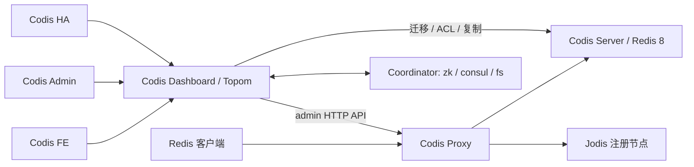

# Codis 架构总览

Codis 是 Redis 的代理式分片集群：客户端只连接 Codis Proxy，proxy 按固定 1024 个 slot 把命令路由到后端 Codis Server；dashboard/topom 通过 coordinator 存储维护 slot 映射、group、proxy、sentinel、ACL 等元数据，并驱动数据迁移、配置下发和故障切换。本文记录仓库当前已落地的拓扑、状态归属与代码位置，用于判断一次改动会触及哪个入口、哪个包、哪些运行期状态，以及哪些变更必须经过 dashboard/topom。

## 术语

| 术语 | 含义 | 位置 |
|---|---|---|
| Codis Proxy | 面向客户端的 Redis 协议代理：认证、命令解析、slot 路由、pipeline 写回和运行期指标 | `cmd/proxy/main.go`、`pkg/proxy/proxy.go` |
| Topom / Codis Dashboard | 集群拓扑管理进程，持有 store、cache、slot action、stats 和 HA 状态，对外暴露管理 HTTP API | `cmd/dashboard/main.go`、`pkg/topom/topom.go` |
| Coordinator / Store | 集群元数据的外部存储抽象：读写、列表、watch、临时节点；实现有 zookeeper、consul、filesystem | `pkg/models/client.go`、`pkg/models/store.go` |
| Slot / Group | Slot 是路由分片单位，固定 1024 个，模型常量与 proxy 内部状态分属两层；Group 是一组后端 Redis Server，第一台按现有代码语义承担 master 位置 | `pkg/models/slots.go`、`pkg/proxy/slots.go`、`pkg/models/group.go` |
| Hot key cache | proxy 进程内、默认关闭、按 exact key 配置的短 TTL string 读缓存；只作用于稳定 slot 上的 `GET`/`MGET` 完整 bulk value，不进入 coordinator；启用广播后 source proxy 可经 dashboard 通知其他 online proxy 删除本地条目 | `pkg/proxy/hot_key_cache.go`、`pkg/proxy/hot_key_cache_broadcast.go` |
| Session auth brute-force guard | proxy 进程内、默认关闭的 `session_auth` `AUTH` 失败保护：按客户端 remote IP 记录失败计数与临时锁定截止时间，不影响已认证 session，不进入 coordinator | `pkg/proxy/auth_bruteforce.go` |
| Codis-managed Redis ACL | 默认关闭的 Redis 8 ACL 管理与 proxy 多账号认证：dashboard 是管理面，coordinator 存 `/codis3/{product}/acl` 目标 revision，topom 先同步后端 Redis 再下发 proxy snapshot；ACL 用户可绑定固定 db（DB-bound ACL user），认证后 proxy 以 Forced DB 强制该 session 路由到绑定 db，优先级高于客户端 `SELECT` | `pkg/topom/topom_acl.go`、`pkg/models/acl.go` |
| Proxy QPS limit | 默认关闭的单 proxy 进程级普通请求 QPS 限流；目标 limit 由 dashboard 写入 coordinator 再经 proxy admin API 下发 | `pkg/proxy/qps_limiter.go`、`pkg/topom/topom_qps_limit.go` |
| Cluster nodes compat | proxy 进程内、默认关闭的 `CLUSTER NODES` 兼容输出，仅为 cluster-mode SDK bootstrap 生成伪 Redis Cluster 节点清单，不改变 1024 slot 真实路由 | `pkg/proxy/cluster_nodes.go` |
| Stream command support | proxy 对 Redis Stream 命令的受控路由子集：单 stream 命令、`XGROUP`/`XINFO` 容器命令、非阻塞同 hash tag `XREAD`/`XREADGROUP`；不是完整 Stream 语义承诺 | `pkg/proxy/stream_commands.go` |
| RDB Analysis / Remote RDB fetch | dashboard 进程内的离线 RDB 文件分析，输出 DB/type/prefix 聚合、big keys、hot keys 与 flamegraph；输入来自上传、受控 workspace 路径，或 dashboard 从当前 product 内 Redis 8 Codis Server 的 RDB HTTP export 受控拉取。不在 proxy 请求路径中执行 | `pkg/topom/topom_rdb_analysis.go`、`pkg/topom/topom_rdb_analysis_remote_fetch.go` |
| RDB HTTP export | Redis 8 Codis Server 上默认关闭的本机 RDB 导出入口：复用 Redis 监听端口，只接受 `GET /codis/rdb/latest` 与 `X-Codis-RDB-Auth` header，不调用 `SAVE`/`BGSAVE` | `extern/redis-8.6.3/src/codis_rdb_export.c` |
| PITR / 数据闪回 | 默认关闭的 dashboard 进程内单 Redis 8 Codis Server AOF 时间点截断恢复编排，复用原生 `aof-timestamp-enabled` 与 `redis-check-aof --truncate-to-timestamp`，不修改 Redis C 源码 | `pkg/topom/topom_pitr.go`、`pkg/topom/topom_pitr_run.go` |

## 系统定位

- 数据面由 proxy 承担：客户端只看到单点 Redis，slot 决定 key 归属，proxy 本身不持久化业务数据；coordinator 只保存拓扑与配置，限流 token、热 key 缓存、防暴破计数、RDB analysis 与 PITR job 只活在单个进程内。
- 控制面由 dashboard/topom 独占：拓扑、迁移动作、ACL 与 QPS limit 目标配置只有它写入 coordinator；同一业务集群同一时刻最多一个 dashboard，所有集群修改都必须经由 dashboard（见 [tutorial_zh.md](tutorial_zh.md)）。
- 不是 Redis Cluster：不实现 cluster bus、gossip、`MOVED`/`ASK`，`CLUSTER NODES` 只是可选兼容输出；Redis 8 Codis Server 使用 `codis-enabled yes` 而非 `cluster-enabled`。

## 组件与交互

| 组件 | 进程入口 | 主要职责与共享状态 |
|---|---|---|
| codis-proxy | `cmd/proxy/main.go` | Redis 协议代理、slot 路由、本地命令、限流/缓存/ACL 运行态；读 coordinator（Jodis、`CLUSTER NODES` all 模式），被 dashboard 通过 admin API 下发 |
| codis-dashboard | `cmd/dashboard/main.go` | 拓扑管理、slot action、配置管理面、RDB Analysis 与 PITR 编排；读写 coordinator 并持有拓扑锁 |
| codis-server | `extern/redis-8.6.3` | 后端存储；Codis mode 下按 1024 slot 组织 keyspace 并支持迁移命令，不依赖 coordinator |
| codis-fe / codis-admin / codis-ha | `cmd/fe/main.go`、`cmd/admin/main.go`、`cmd/ha/main.go` | 前端静态资源与 dashboard 反向代理；CLI 操作入口；周期巡检与 promote。三者只调 dashboard/proxy API，不直连 coordinator |
| coordinator / Jodis | `pkg/models`、`pkg/proxy/jodis.go` | 保存 `/codis3/{product}` 元数据与 `/jodis/{product}/proxy-{token}` proxy 临时注册节点 |

### Codis Proxy

- 启动与会话：`Proxy.New` 创建 router、启动 admin/proxy 服务与 metrics reporter，`Proxy.setup` 填入两个 listener 的 model；`serveProxy` accept 后为每个连接创建 `Session`，reader 解码 Redis multi bulk 生成 `Request` 交给 router，writer 等待后端响应后按原序写回。活动 session 注册进进程内 `clientSessionRegistry`，只服务 `CLIENT LIST` 与 `SessionsAlive()`，不进 coordinator、不跨 proxy 同步。
- 命令分流：`Session.handleRequest` 先处理 `QUIT`、`AUTH` 与鉴权状态，再执行可选 QPS 检查，然后处理 `SELECT`、`CLIENT LIST`、`ACL WHOAMI`、启用后的 `CLUSTER NODES` 等本地命令，`GET`/`MGET`/`MSET`/`DEL`/`EXISTS`/`SLOTSINFO`/`SLOTSSCAN`/`SLOTSMAPPING` 走特殊处理，其余命令走 `Router.dispatch`。
- 转发与迁移：`Router.dispatchByHashKey` 用 hash key 计算 slot 并调用 `Slot.forward`；迁移中的 slot 由 `forwardSync`/`forwardSemiAsync` 包装，`SLOTSMGRT-EXEC-WRAPPER` 由 `forwardHelper.slotsmgrtExecWrapper` 解析。
- 默认关闭的本地能力：Hot key cache、QPS limit、brute-force guard、`CLUSTER NODES` 兼容、ACL 多账号，均只影响单个 proxy 进程；观测面是 `/api/proxy/...` 的 stats/model/slots API 与 JSON、InfluxDB、StatsD 上报。

### Codis Dashboard / Topom

- `topom.New` 载入 store 与 cache，`Topom.Start` 启动周期任务：刷新 Redis/proxy stats、处理 slot action、观察 sentinel；启动时通过 `Store.Acquire` 抢占 `/codis3/{product}/topom` 拓扑锁，同一集群同时只能有一个 active dashboard。
- 下发：`ReinitProxy` 向 proxy 填充 slot、启动 proxy 并设置 sentinel；局部 slot 变更由 `resyncSlotMappings` 并发调用所有 proxy 的 `FillSlots`。
- 迁移：`SlotCreateAction*` 在 slot mapping 上写 action，`ProcessSlotAction` 与 `newSlotActionExecutor` 把状态从 pending 推进到 preparing/prepared/migrating/finished，实际搬迁调用 Redis 侧 `SLOTSMGRT*`。
- 管理 API：`newApiServer` 注册 proxy、group、slot action、rebalance、sentinel、ACL、QPS limit、hot key cache invalidation、RDB Analysis、PITR 路由；除 overview/model/stats/slots 等只读路由外均要求 `xauth`。`RDBAnalysisManager` 与 `PitrManager` 的 job 都不写 coordinator，dashboard 重启后任务消失。

### Codis Server（内嵌 Redis 8）

- 历史背景：早期版本基于 Redis 3.2 内核，该支持已移除；当前唯一内置版本为 Redis 8。
- 源码位于 `extern/redis-8.6.3`。`codis-enabled` 与 `cluster-enabled` 互斥；Codis mode 保留 standalone 多 DB 行为，DB keyspace 使用 10-bit `kvstore`/`estore` 分区，slot keyspace 的唯一权威来源是 `kvstore`，不维护 `hash_slots[1024]` 平行索引。slot 命令为 `SLOTSHASHKEY`、`SLOTSINFO`、`SLOTSSCAN`、`SLOTSDEL`、`SLOTSCHECK`：`SLOTSDEL` 先收集 key 快照再走 Redis 正常删除路径，`SLOTSCHECK` 校验 key 所在 dict index 与 Codis hash slot 一致。
- 同步迁移：源端 `SLOTSMGRTSLOT`/`SLOTSMGRTONE`/`SLOTSMGRTTAGSLOT`/`SLOTSMGRTTAGONE` 复用 `server.slotsmgrt_cached_sockets` 中按 `host:port` 缓存的裸 TCP 连接，用 `createDumpPayload` 生成 RDB fragment 并发送 `SLOTSRESTORE`；目标端恢复成功后源端才删除本地 key，并把删除传播为确定性 `DEL`。
- 异步迁移：`src/slots_async.c` 承载 `SLOTSMGRT*-ASYNC`、`SLOTSRESTORE-ASYNC*` ACK 子协议、per-DB cached migration client、`FENCE`/`CANCEL`/`STATUS` 与 `EXEC-WRAPPER` 写保护；`redisDb.codis_tagged_keys` 只记录带 `{...}` hash tag 的 key，score 使用完整 CRC32，供 tag-aware 迁移扩展同 tag key。
- 本机 RDB export：复用 Redis 端口，`networking.c` 在 parser 前识别精确 HTTP 请求，IO thread 只做标记并转回主线程；auth、文件校验与 streaming 都在主线程完成，`codis-rdb-export-rate-limit` 为 server 级 body bytes/sec 预算。

### 运维入口：codis-fe / codis-admin / codis-ha

- `codis-fe`：`StaticLoader`/`DynamicLoader` 提供 dashboard 列表，`ReverseProxy` 按名字转发；ACL、Proxy QPS Limit、RDB Analysis、PITR 区域全部只调用 dashboard API，不直连 proxy admin API 或 Redis Server。`codis-ha` 的 `HealthyChecker.Maintains` 周期读取 dashboard stats，按 `maxdown` 阈值清理或 promote。
- `codis-admin`：按参数分发到 proxy 或 dashboard 操作；`--acl`/`--acl-set FILE` 读取与提交 ACL view（dry-run 输出 redact `new_password`）；`--rdb-analysis-remote-fetch --server=ADDR` 只打印 job id、不接收 Redis export auth；`--pitr-*` 创建、查询、取消、删除 PITR job。三者最终都落在 dashboard API 或 proxy admin API 上，没有绕过 dashboard 直接改 coordinator 的路径。

### 构建与发布层

- `go.mod` 声明 `go 1.26.1`，`vendor/`、`Godeps/` 已退休；默认 cmd/pkg 构建与测试、`cgo_jemalloc` proxy 构建、`make gotest` 都在 module mode 下工作，`cgo_jemalloc` 通过 `replace github.com/spinlock/jemalloc-go => ./third_party/jemalloc-go` 指向仓库内受控本地模块。
- `Makefile` 产出 `codis-dashboard`、`codis-proxy`、`codis-admin`、`codis-ha`、`codis-fe` 和嵌入式 `codis-server`，并刷新 tracked 的 `config/dashboard.toml`、`config/proxy.toml`、`config/redis.conf`、`config/sentinel.conf`；默认 `make`/`make codis-server` 从 `extern/redis-8.6.3` 构建正式 Redis 8 Codis Server，复制为 `bin/codis-server`、`bin/redis-cli`、`bin/redis-benchmark`、`bin/redis-sentinel`。
- 显式平台矩阵：`make build-platforms` / `make release-platforms`，默认 `TARGET_PLATFORMS` 为 `darwin/arm64 linux/amd64 linux/arm64`，产物落在 `bin/<os>-<arch>/`；`build-platform-artifact` 先做 target allowlist、unsafe label 校验与 C/cgo cross toolchain guard，非 host full build 缺少 `ALLOW_CROSS_FULL_BUILD=1` 与对应 `PLATFORM_CC_<os>_<arch>` 时 fail-fast。`build-no-redis-platform` 只产出 `bin/<os>-<arch>-no-redis/` 下的 Go 入口、FE assets 和配置副本，不构建 Redis Server 与 helper，也不承诺纯 Go（非 jemalloc allocator 路径仍使用 cgo）。
- 版本元数据由 `pkg/utils/version.go` 提供 clean checkout 兜底，`version` 脚本生成 `bin/version` 与 `bin/version.ldflags`，Makefile 通过 `-ldflags -X` 注入；发布包装入口为 `Dockerfile`、`scripts/docker.sh`、`example/server.py`、`kubernetes/codis-server.yaml`。

## 数据与状态

### coordinator 命名空间与后端

| 路径 | 模型 | 写入方 / 语义 |
|---|---|---|
| `/codis3/{product}/topom` | `models.Topom` | dashboard 启动时抢占的拓扑锁 |
| `/codis3/{product}/slots/slot-XXXX` | `models.SlotMapping` | dashboard；`Action` 记录迁移状态与 target group |
| `/codis3/{product}/group/group-XXXX` | `models.Group` / `GroupServer` | dashboard；master 为 group 内第一台 |
| `/codis3/{product}/proxy/proxy-{token}`、`/codis3/{product}/sentinel` | `models.Proxy` / `models.Sentinel` | dashboard 注册、状态维护与 sentinel 配置同步 |
| `/codis3/{product}/acl` | `models.ACL` | dashboard 提交的 ACL 目标 revision，只存 password hash |
| `/codis3/{product}/proxy_qps_limit` | `models.ProxyQPSLimit` | dashboard 提交的 QPS limit 目标 revision |
| `/jodis/{product}/proxy-{token}` | proxy 注册数据 | proxy 自身创建与续约的临时节点 |

- `models.NewClient` 按 `zk`/`fs`/`consul` 构造实现，上层只依赖 `models.Client`；`models.NewStore` 在其上加 product 命名空间与缓存失效，路径 helper 集中在 `pkg/models/store.go`（`LockPath`、`SlotPath`、`GroupPath`、`ProxyPath`、`SentinelPath`、`ACLPath`、`ProxyQPSLimitPath`）。`pkg/proxy/jodis.go` 的 `Jodis` 在 `/jodis/{product}/proxy-{token}` 维护临时节点：`Start` 创建、`Rewatch` 在被删除后重建、`Close` 释放，Consul 后端用 Session 表达该 ephemeral ownership。
- ACL 元数据只保存 revision、enabled、user enabled、password hash、rules 和 updated_at，不保存客户端明文密码；QPS limit 模型只保存 revision、limit 和 updated_at，不保存每秒 token 状态。

### dashboard/topom 进程内状态

`Topom` 分 model、store、cache、action、stats、ha、aclSync、rdbAnalysis 几块：cache 保存 slots/group/proxy/sentinel/ACL/QPS limit 快照；action 保存迁移执行状态；stats 保存 Redis 与 proxy 统计；ha 保存 sentinel 观察到的 masters；aclSync 保存最近一次 ACL 下发的 per-proxy 失败结果与 `sync_status`；rdbAnalysis 保存 job registry、analysis 并发限制、remote fetch 计数、上传 workspace、临时文件路径和结果快照。

### proxy 进程内状态

- `Proxy` 持有身份认证 token、`models.Proxy`、两个 listener、router、HA sentinel monitor、可选 Jodis 注册器、默认关闭的 brute-force guard 和活动 session registry；`Router` 持有 1024 个 `Slot`、主从后端连接池、online/closed 状态、`ACLSnapshot`、按 ACL revision 绑定的 user-bound backend pools、默认关闭的 `HotKeyCache`、broadcast reporter 与 cluster nodes provider（`self` 模式保存本 proxy 快照，`all` 模式周期读取 Jodis 注册记录并过滤坏 JSON、空地址、非 online、重复 token/addr 后生成 `0-16383` 伪节点，命令路径只读内存快照）。
- ACL snapshot 采用 copy-on-write：新 revision 安装时关闭旧 user pools，把旧 revision 的已认证 session 标记 stale，下一条非 `AUTH` 命令返回重新认证要求；session identity 保存 username、credential hash、短期 password、revision 和可选 ForcedDB，只用于 backend reconnect。
- `HotKeyCache` 以 `database + raw Redis key bytes` 为条目 key，保存 copied bulk bytes、slot id、expire time、LRU 元素与统计；读 miss 回填前校验 slot version 与 cache 全局失效 version，防止旧响应被重新写回。broadcast reporter 只保存 source proxy token、dashboard admin addr、xauth、HTTP timeout 与有界事件队列，队列内只有 DB+raw key bytes。
- `QPSLimiter` 保存 applied revision、limit、tokens、last_refill、accepted、rejected，调低 limit 时 clamp 当前 burst；brute-force guard 以规范化客户端 IP 为 key 保存 `failures`、`lastFailureAt`、`lockedUntil` 和聚合统计，状态表有固定 tracked IP 上限。
- 后端连接：service connection 按配置发送 `AUTH [username] password` 与按 DB `SELECT`，user-bound connection 使用 session ACL identity；stale keepalive 只在 `INFO` 的 `loading` 不为 1、`master_link_status` 不为 `down` 时恢复。

### 状态归属与收敛

| 状态 | 归属 | 传播 / 收敛方式 |
|---|---|---|
| slot 映射、group、proxy、sentinel | coordinator | dashboard 写，proxy 通过 admin API 接收下发 |
| ACL revision、QPS limit 目标值 | coordinator | dashboard 写，再 fan-out 到后端 Redis 与 online proxy |
| 业务数据 | 后端 Redis | 不进入 coordinator |
| hot key cache 条目 | 单个 proxy | TTL 收敛，或经 dashboard 广播删除 |
| QPS token bucket、accepted/rejected、brute-force 计数 | 单个 proxy | 仅通过 proxy stats 上报 revision/limit；重启清空计数与锁定 |
| RDB analysis job、PITR job 与 per-server lock | dashboard | 进程内，重启丢失；PITR lock 持续到显式 Remove |

## 代码地图

### cmd/

| 路径 | 符号 / 关键内容 |
|---|---|
| `cmd/proxy/main.go`、`cmd/dashboard/main.go` | `main`：proxy 解析参数与配置并按 dashboard、coordinator、`--fillslots` 三种方式上线；dashboard 创建 coordinator client、`topom.New` 并在启动时抢占拓扑锁 |
| `cmd/admin/main.go`、`cmd/admin/proxy.go`、`cmd/admin/dashboard.go`、`cmd/admin/pitr.go`、`cmd/admin/rdb_analysis_remote_fetch.go` | CLI 参数分发、proxy/dashboard 操作、ACL view 读取与提交（dry-run redaction）、`--pitr-*`、`--rdb-analysis-remote-fetch` |
| `cmd/fe/main.go`、`cmd/fe/assets/{index.html,acl.js,qps-limit.js,rdb-analysis.js,pitr.js}`、`cmd/ha/main.go`、`cmd/internal/coordinator/args.go` | `StaticLoader`/`DynamicLoader`/`ReverseProxy` 与 FE 各配置区域；`main`、`HealthyChecker.Maintains` 巡检；`Parse`/`MustParse` 共用 coordinator CLI 参数解析 |

### pkg/proxy

| 路径 | 符号 / 关键内容 |
|---|---|
| `pkg/proxy/proxy.go`、`pkg/proxy/proxy_api.go` | `Proxy`、`New`、`setup`、`Start`、`serveProxy`、`serveAdmin`、`Stats`、`Overview`；`newApiServer`、`ApiClient`、`SetACL`、`SetQPSLimit`、`HotKeyCacheInvalidate`、`FillSlots` |
| `pkg/proxy/session.go`、`pkg/proxy/slots.go` | `Session`、`serve`、`handleRequest`、`handleRequestMGet`/`MSet`/`Del`/`Exists`、`handleRequestSlotsInfo`/`SlotsScan`/`SlotsMapping`；`Slot`、`blockAndWait`、`unblock`、`forward` |
| `pkg/proxy/session_auth.go`、`acl.go`、`acl_backend.go` | `Session.handleAuth`、`handleLegacyAuth`、`handleACLAuth`、`ACLSnapshot`、user-bound backend pool、`ACL DRYRUN` |
| `pkg/proxy/router.go`、`pkg/proxy/forward.go`、`pkg/proxy/backend.go` | `Router`、`dispatch`、`dispatchByHashKey`、`dispatchSlot`、`FillSlot`、`fillSlot`、`SetACL`；`forwardSync`、`forwardSemiAsync`、`forwardHelper.slotsmgrt`/`slotsmgrtExecWrapper`；`BackendConn`、`NewBackendConnWithAuth`、`KeepAlive` |
| `pkg/proxy/client_list.go`、`pkg/proxy/stats.go` | `clientSessionRegistry`、`handleRequestClientList`、`formatClientList`；`opStats`、`OpStats`、`OpTotal`、`OpRedisErrors`、`OpQPS` |
| `pkg/proxy/cluster_nodes.go`、`stream_commands.go`、`mapper.go` | `clusterNodesProvider`、`loadJodisNodes`、`normalizeClusterNodes`；`streamCommandSpecs`、`registerStreamCommandOps`、`resolveStreamRoute`、`Router.handleRequestStream`；`OpFlag`、`OpInfo` 与命令 allow-list |
| `pkg/proxy/qps_limiter.go`、`hot_key_cache.go`、`hot_key_cache_broadcast.go`、`auth_bruteforce.go`、`jodis.go`、`metrics.go`、`redis/redistest` | `QPSLimiter`、`QPSLimitConfig`、`QPSLimitStats`；`HotKeyCache`、`hotKeyCacheInvalidationPlan`；`hotKeyCacheBroadcastReporter`、`HotKeyCacheBroadcastRequest`；`AuthBruteforceGuard`、`AuthBruteforceStats`；`Jodis`、`NewJodis`、`Rewatch`；`startMetricsReporter`、`startMetricsJson`/`Influxdb`/`Statsd`；fake Redis server helper |

### pkg/topom

| 路径 | 符号 / 关键内容 |
|---|---|
| `pkg/topom/topom.go`、`topom_api.go`、`topom_cache.go`、`topom_stats.go` | `Topom`、`New`、`Start`、`runPeriodic`、`Stats`、`Overview`；`newApiServer`、`verifyXAuth`；`refillCache`、`storeUpdateSlotMapping`/`ACL`/`ProxyQPSLimit`；`RedisStats`、`RefreshRedisStats` |
| `pkg/topom/topom_action.go`、`topom_slots.go` | `ProcessSlotAction`、`processSlotAction`、`ProcessSyncAction`；`SlotCreateAction`、`SlotCreateActionSome`、`SlotCreateActionRange`、`SlotActionPrepareFilter`、`SlotActionComplete`、`newSlotActionExecutor`、`SlotsRebalance` |
| `pkg/topom/topom_group.go`、`topom_proxy.go`、`topom_sentinel.go` | group/server 增删与主从 promotion；`CreateProxy`、`OnlineProxy`、`ReinitProxy`、`resyncSlotMappings`；sentinel 配置同步与 master 切换 |
| `pkg/topom/topom_acl.go`、`topom_acl_api.go`、`topom_qps_limit.go`、`topom_hot_key_cache.go` | `ACLView`、`ACLUpdateRequest`、Redis `ACL SETUSER` 同步与 proxy snapshot fan-out；`ProxyQPSLimitView`、revision 写入、proxy fan-out 与 `sync_status`；hot key cache 失效 fan-out |
| `pkg/topom/topom_rdb_analysis.go`、`topom_rdb_analysis_api.go`、`topom_rdb_analysis_remote_fetch.go`、`topom_pitr.go`、`topom_pitr_run.go`、`topom_pitr_api.go`、`topom_pitr_disk.go` | `RDBAnalysisManager`、`RDBAnalysisJob`、`RDBAnalysisOptions`、`rdbAnalysisSnapshot`、`rdbAnalysisFlameBuilder`；`RDBAnalysisUpload`/`Start`/`RemoteFetch`/`Get`/`Cancel`/`Remove`、`startRDBAnalysisRemoteFetch`、`fetchRemoteRDB`；`PitrManager`、`PitrJob`、`PitrStep`、`pitrServerLock`、9 步状态机（validate/prereq/feasibility/shutdown/snapshot/truncate/restart/wait-load/resync）、`PitrCreate` 等 handler、bin preflight 与 free disk 辅助 |

### pkg/models 与 pkg/utils

| 路径 | 符号 / 关键内容 |
|---|---|
| `pkg/models/client.go`、`store.go` | `Client` 接口（Create/Update/Delete/Read/List/WatchInOrder/CreateEphemeral）、`NewClient`；`Store`、`NewStore`、路径 helper、`ValidateProduct` |
| `pkg/models/slots.go`、`action.go` | `MaxSlotNum`、`ForwardSync`/`ForwardSemiAsync`、`Slot`、`SlotMapping`；`ActionPending`、`ActionPreparing`、`ActionPrepared`、`ActionMigrating`、`ActionFinished`、`ActionSyncing` |
| `pkg/models/group.go`、`proxy.go`、`sentinel.go`、`proxy_qps_limit.go`、`acl.go` | `Group`、`GroupServer`、`Proxy`、`Sentinel`、`ProxyQPSLimit`、`ACL`、`ACLUser`（含 `DB` 绑定字段）、`ACLPasswordHash` |
| `pkg/models/consul`、`zk`、`fs` | 三种 coordinator 实现；Consul 为 `consul.Client` + KV/Session |
| `pkg/utils/redis/client.go` | `Client`、`Pool`、`InfoCache`、`NewClient`、`NewClientWithAuthIdentity`、`InfoFull`、`SetMaster`、`SlotsInfo`、`MigrateSlot`、`MigrateSlotAsync` |
| `pkg/utils/redis/reply.go`、`sentinel.go` | `replyString`、`replyInt`、`replyInts`、`replyStringMap` 等 reply shape 解析；`Sentinel`、`SentinelMaster`、`SentinelGroup`、`Subscribe` |
| `pkg/utils/version.go`、`version` | clean checkout 版本兜底与 ldflags 注入来源 |

### extern/redis-8.6.3（Redis 8 Codis Server）

| 路径 | 符号 / 关键内容 |
|---|---|
| `extern/redis-8.6.3/src/config.c`、`server.h`、`server.c`、`db.c`、`lazyfree.c` | `codis-enabled` 状态、1024 slot `kvstore` keyspace、Codis CRC32 slot 计算、flush/temp DB 重建 |
| `extern/redis-8.6.3/src/slots.c`、`src/commands/slotshashkey.json`、`slotsinfo.json`、`slotsscan.json`、`slotsdel.json`、`slotscheck.json`、`tests/unit/codis.tcl` | slot 查询/统计/扫描/删除/一致性检查、slot keyspace 与 tag index helper |
| `extern/redis-8.6.3/src/slots.c`、`server.h`、`server.c`、`src/commands/slotsmgrt*.json`、`slotsrestore.json`、`tests/unit/codis_migration.tcl`、`codis_slotsrestore.tcl` | 同步迁移、RDB fragment restore、`slotsmgrt_sockfd` socket 缓存 |
| `extern/redis-8.6.3/src/slots_async.c`、`networking.c`、`blocked.c`、`src/commands/*async*.json`、`slotsmgrt-exec-wrapper.json`、`tests/unit/codis_async_migration.tcl` | 异步迁移、restore async ACK、per-DB cached client、fence/cancel/status、exec wrapper 写保护 |
| `extern/redis-8.6.3/src/slots.c`、`slots_async.c`、`config.c`、`server.h` | `codis-migration-auth-user` / `codis-migration-auth-pass` named ACL 认证 |
| `extern/redis-8.6.3/src/codis_rdb_export.c`、`networking.c`、`iothread.c`、`server.h`、`server.c`、`config.c`、`tests/unit/codis_rdb_export.tcl` | RDB HTTP export：parser 前识别、IO-thread 主线程转交、文件校验、fd streaming、server 级 token bucket、`CONFIG SET` clamp |

### third_party 与构建发布

| 路径 | 符号 / 关键内容 |
|---|---|
| `third_party/jemalloc-go` | `github.com/spinlock/jemalloc-go` 的本地 replace 模块，提供 `cgo_jemalloc` 所需 wrapper、头文件与 C 源码 |
| `third_party/rdb` | `github.com/hdt3213/rdb` 的最小 fork，支持 Redis 8 RDB version 13 与 Stream type 26 |
| `Makefile`、`extern/redis-8.6.3/Makefile`、`extern/redis-8.6.3/src/Makefile` | `build-all`、`build-platforms`、`release-platforms`、`build-platform-artifact`、`build-no-redis-platform`；Redis 8 源码接入点（`codis_rdb_export.o` 在同一 Makefile 中登记） |
| `config/redis.conf`、`config/sentinel.conf` | Redis 8 Codis Server tracked 默认模板，`redis.conf` 显式包含 `codis-enabled yes` |
| `go.mod`、`go.sum` | module 依赖、`replace` 指令与校验锁定 |
| `Dockerfile`、`scripts/docker.sh`、`example/server.py`、`kubernetes/codis-server.yaml`、`scripts/redis8_local_validation.py` | 发布包装与本地示例入口；本地 Mac 非性能 validation gate（临时 filesystem coordinator/dashboard/proxy/Redis 8 group，不是生产入口） |

## 已知约束与边界

### 编译与构建

- 仓库已有完整 Go modules 编译闭环：默认 cmd/pkg 可编译测试，`cgo_jemalloc` proxy 经本地 replace 模块在 module mode 下构建，`make gotest`、`make build-all` 不再依赖 GOPATH/vendor 参数；旧 `vendor/`、`Godeps/` 已退休。
- 默认 `make`/`make build-all` 是 host build，显式多平台发布走 `make build-platforms`/`make release-platforms`，首版 allowlist 为 `darwin|linux` × `amd64|arm64`。完整非 host 产物需要原生 target runner 或显式 C/cgo cross toolchain，仅设 `GOOS`/`GOARCH` 不能保证 Redis 8 与 proxy cgo 产物正确。
- `go.mod` 使用 `go 1.26.1`。Go Redis helper 的第三方 client 固定 `github.com/redis/go-redis/v9`，必须保持 RESP2、禁用 identity、禁用 command retry，并用 dedicated connection 维持 Codis 的单连接 DB 和 pipeline 计数语义；测试用 fake Redis 需对 `HELLO` 返回 Redis error 以触发 RESP2 fallback。
- `Makefile` 的组件构建会刷新 `config/dashboard.toml`、`config/proxy.toml`、`config/redis.conf`、`config/sentinel.conf`。

### proxy 命令面与协议

- proxy 通过普通 Redis 协议面向客户端，但不支持全部 Redis 命令（见 [unsupported_cmds.md](unsupported_cmds.md)）。`CLIENT` 命令族只支持 `CLIENT LIST`，语义限定为当前 proxy 实例的活动客户端连接快照：不聚合多 proxy、不下探后端 Redis、不承诺 Redis 8.6.3 全字段 parity，其余 `CLIENT` 子命令仍不支持。
- `CLUSTER` 命令族默认不可用。只有 `cluster_nodes_compat = "self"` 或 `"all"` 时 `CLUSTER NODES` 才返回伪节点清单；`0-16383` 是 Redis Cluster 逻辑 slot 输出，不代表 Codis 真实路由（真实 `MaxSlotNum` 仍为 1024）。不实现其他 `CLUSTER` 子命令、`MOVED`/`ASK`、cluster bus、gossip、failover 和 cluster 配置文件；`all` 模式只轮询 Jodis/coordinator 注册信息，不做 proxy 间 RPC、探活或广播，也不读取 Consul service catalog、health check 或 service mesh API。
- Redis Stream support 是 Redis 8 backend 的 proxy 路由子集，不是完整 Stream 支持声明。`XGROUP HELP`、`XINFO HELP`、未知 Stream subcommand、带 `BLOCK` 的 `XREAD`/`XREADGROUP` 和跨 hash tag multi-stream 会被 proxy 直接拒绝；后端必须是 Redis 8 Codis Server，proxy 不伪造成功响应。该能力不新增 Vector Set、Hash field expiration、模块数据类型、配置开关、dashboard/FE 页面、coordinator schema 或 proxy admin API。
- Hot key cache 是 opt-in bounded-stale 能力：默认关闭，只缓存 allowlist 中 exact key 的 `GET`/`MGET` string bulk value，写命令不做写穿填充。广播链路 best-effort，失败、队列满、proxy 离线或 dashboard 不可达都不改变客户端写响应，未收到通知的 proxy 靠 TTL 收敛；不做自动热点探测、dashboard 管理页、coordinator 元数据、proxy-to-proxy 通信，也不缓存派生读或非 string value；slot 迁移或锁定状态不从 cache 返回。
- session auth brute-force guard 默认关闭，只保护 proxy 客户端 `AUTH <password>` 的 `session_auth` 校验。不改变 `product_auth`、dashboard `xauth`、coordinator/Jodis auth 或后端 Redis auth，不实现 ACL username 维度、手动解锁 API、allowlist/denylist/CIDR 或跨 proxy 全局计数；锁定状态只在单 proxy 进程内，重启清空；NAT、四层代理或负载均衡会让多个真实客户端在 proxy 视角共享同一来源 IP；已认证 session 不因后续同 IP 锁定被关闭或降级。

### 数据面与迁移

- slot 数固定 1024，改变该常量会同时影响模型、路由、迁移和外部元数据兼容性。
- `product_name` 同时参与元数据命名空间、proxy/dashboard 鉴权和运行期路由隔离，格式校验见 `pkg/models/store.go` 的 `ValidateProduct`。
- Redis 8 同步迁移的安全边界是「目标端确认写入成功后才删除源端 key」：connect/write/read、AUTH、SELECT 或 `SLOTSRESTORE` 任一失败都会关闭对应 socket 缓存并返回错误，不删除源端数据；成功路径只传播 `DEL`，不传播原始 `SLOTSMGRT*` 命令。
- 异步迁移同样遵守「所有 ACK 成功后才删除源端 key」：connect/write/read、AUTH、SELECT、restore async ACK、timeout、cancel 或 client close 任一失败都保留源端数据；同一 DB 同时只允许一个 async migration，`SLOTSMGRT-ASYNC-STATUS`/`FENCE`/`CANCEL` 按当前 DB 隔离。
- 迁移只保证 Redis 8 ↔ Redis 8；不承诺跨大版本 fragment 或持久化 RDB/AOF 兼容。
- 默认 `make`/`make codis-server` 构建内嵌 Redis 8 Codis Server，`config/redis.conf` 显式 `codis-enabled yes`，但仍不启用 Redis Cluster 协议；`make codis-server-redis8` 只是默认 Redis 8 产物的 suffixed alias。
- 本地 Mac validation gate 不产出性能、fork/RDB、复制或网络栈的正式结论；所有 throughput/latency、RDB/fork、replication、Docker 包装和生产 cutover 判断以 Linux 验证为准（见 [redis8_validation_zh.md](redis8_validation_zh.md)）。

### 配置管理与运维语义

- Codis-managed Redis ACL 默认关闭，旧 `session_auth` 与 password-only backend auth 保持兼容。启用后 ACL source of truth 是 dashboard 提交到 coordinator 的 `/codis3/{product}/acl` revision，并同步到 Redis Server 与 proxy snapshot；普通客户端不能通过 proxy 执行 ACL 管理命令，FE 只能调用 dashboard ACL API。当前只管理 Redis 8 OSS ACL 用户、命令和 key pattern，不实现 RESP3/HELLO parity、Redis Cluster ACL、Pub/Sub channel ACL、Redis Stack/module key-spec 语义或跨 dashboard 分布式原子 rollout；fan-out 部分失败时在 `sync_status` 暴露 partial failure 并允许幂等重试。ACL 用户的 db 绑定是 proxy 路由属性，不渲染进 Redis `ACL SETUSER`、不放大权限；topom 只校验 db 非负，上限由 proxy 在认证时按 `backend_number_databases` fail-closed 兜底，且仅在 `codis_acl_enabled` 下生效。
- Proxy QPS limit 默认关闭，0 表示不限制，正数表示单个 proxy 进程内所有 session 共享的普通请求 QPS 上限。它不是跨 proxy 分布式限流，不实现 per-client、per-IP、per-user、per-command、per-DB、per-slot、per-key 或 per-backend group 限流，也不把每秒 token 状态写入 coordinator。业务客户端的 `CONFIG` 命令族仍不开放；被拒绝的请求返回 Redis error 文本，但不代表后端 Redis 错误。
- PITR / 数据闪回默认关闭，只做单 Redis 8 Codis Server 级 AOF 时间点截断恢复：不做跨 group 全局一致性恢复、不做指定 key 子集恢复、不修改 Redis C 源码、不自动开启 AOF 或 `aof-timestamp-enabled`、不做 AOF 保留策略/轮转/备份管理、不实现跨机 AOF 文件操作（scp/rsync/NFS）、不编排 proxy 只读切换、不在业务 Redis 协议路径暴露 PITR 命令、不把 job 写入 coordinator。它依赖运维预先开启 AOF、文件系统直访目标 server AOF 目录，并由外部进程管理器拉起 redis（dashboard 绝不 fork redis-server）。PITR 不幂等：per-server lock 持续到 operator 显式 Remove；SHUTDOWN 后用新连接探活确认 server 真停才继续；truncate 前快照 manifest 与最后 segment 使 `ftruncate` 可逆，并用双向 stat-diff 检测模型漂移；truncate 失败不自动重启。
- RDB Analysis 只分析「已经存在的 RDB 文件」：上传先落到 dashboard 的 `rdb_analysis_workspace/uploads` 临时文件，本地路径模式只能读取 `rdb_analysis_workspace` 下文件，remote fetch 模式只能从当前 product model 里的 Redis 8 Codis Server 拉取固定 `GET /codis/rdb/latest`。它不自动执行 `BGSAVE`/`SAVE`、不读取 Redis Server 机器任意路径、不实现 replication stream 抓取，也不支持 tus、Range 或断点续传；结果可能包含 key 名，所有 API 都要求 `xauth`，任务与结果只保存在 dashboard 进程内存。
- Redis 8 RDB HTTP export 只导出当前 `server.rdb_filename` 对应的已存在本机 RDB 文件，默认关闭，依赖独立 `X-Codis-RDB-Auth` header secret 与 Redis 端口网络隔离；不复用 Redis `AUTH`/ACL，不提供 Range、压缩、加密、独立 HTTP 端口、目录扫描或客户端指定路径。`codis-rdb-export-enabled` 与 `codis-rdb-export-auth` 是 immutable config，开启需重启；`codis-rdb-export-rate-limit` 默认 0 不限速，可运行期调整为所有 export 连接共享的 server 级 body bytes/sec，但不承诺 per-client fairness、并发连接上限或硬事件循环优先级。生产使用仍需配合网络隔离、TLS 或外层访问控制。
- 对同一个业务集群，同一时刻最多一个 dashboard，且所有集群修改都经由 dashboard 完成。

## Consul coordinator 边界

Consul 后端位于 `pkg/models/consul`，只接入 HashiCorp Go API 模块 `github.com/hashicorp/consul/api`，把 Codis 的 slash path 转成无前导 `/` 的 Consul KV key（`/codis3/{product}/topom` 对应 `codis3/{product}/topom`）：`Create` 使用 `KV.CAS(ModifyIndex=0)`，`List` 使用 `KV.Keys(prefix, "/", ...)`，`WatchInOrder` 使用 blocking query 的 `WaitIndex`；Jodis ephemeral 节点使用 `Session.CreateNoChecks` + `KV.Acquire` + `Session.RenewPeriodic`，`Delete`/`Close` 销毁 session 且只删除仍归属当前 session 的 key；Consul token 通过 `coordinator_auth` / `jodis_auth` 写入 API client config，不进入结构化日志。

边界：该后端只覆盖 Codis 需要的 KV、blocking query 和 Session ephemeral 语义，不表示 Codis 使用 Consul service catalog、health check 或 service mesh；不提供 Zookeeper/filesystem 到 Consul 的存量元数据迁移；默认 coordinator 不变，dashboard、proxy、admin、fe 仍通过原有配置/CLI 参数选择后端。

## 第三方依赖 fork：third_party/rdb

`third_party/rdb` 是 `github.com/hdt3213/rdb` 的最小 fork，通过根 `go.mod` 的 `replace github.com/hdt3213/rdb => ./third_party/rdb` 接入。存在理由是上游 v1.3.2 解析不了 Redis 8.6.3 生成的 `REDIS0013`（报 `cannot parse version: 13`），而 dashboard 的 RDB Analysis 必须能读 Redis 8 Codis Server 产出的 RDB。fork 的差异面保持在 parser 最小集：

- 接受 RDB version 13；
- 支持 `RDB_TYPE_STREAM_LISTPACKS_4`（26）及 Redis 8.6 IDMP 元数据；
- 跳过 Redis 8 新增的 `RDB_OPCODE_KEY_META`（243）与 `RDB_OPCODE_SLOT_INFO`（244）；
- 为 stream 补齐 `GetElemCount()`。

升级上游版本时必须重新确认以上四点，否则 Redis 8 RDB 会在 dashboard 侧解析失败。

## 相关文档

- [tutorial_zh.md](tutorial_zh.md)：组件说明、快速启动、HA 与部署。
- [redis8_codis_server_zh.md](redis8_codis_server_zh.md)：Redis 8 Codis Server 的 Codis mode、slot keyspace 与迁移实现。
- [codis_acl_zh.md](codis_acl_zh.md)：Codis-managed Redis ACL、多账号认证与 db 绑定。
- [pitr_flashback_zh.md](pitr_flashback_zh.md)：PITR / 数据闪回的状态机与安全边界。
- [proxy_protocol_extensions_zh.md](proxy_protocol_extensions_zh.md)：proxy 的本地命令与协议扩展。
- [proxy_hot_key_cache_zh.md](proxy_hot_key_cache_zh.md)：热 key 缓存配置、一致性模型与 stats。
- [proxy_qps_rate_limit_zh.md](proxy_qps_rate_limit_zh.md)：Proxy QPS limit 配置、动态管理与拒绝语义。
- [proxy_session_auth_bruteforce_zh.md](proxy_session_auth_bruteforce_zh.md)：`session_auth` 防暴力破解配置与锁定语义。
- [rdb_analysis_zh.md](rdb_analysis_zh.md)：RDB Analysis 使用方式与边界。
- [build_and_release_zh.md](build_and_release_zh.md)：构建、平台矩阵与发布产物。
- [redis8_validation_zh.md](redis8_validation_zh.md)：Redis 8 本地与 Linux 验证矩阵。
- [capability_boundaries_zh.md](capability_boundaries_zh.md)：各项能力的统一边界清单。
