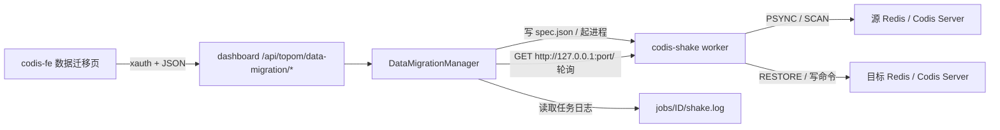

# 数据集成控制台 / 数据迁移

Codis Dashboard 提供“数据集成控制台”：在 codis-fe 的 `数据集成 / 数据迁移` 页面创建、查看、停止、删除数据迁移任务，在单机版 Redis（standalone，含主从）、集群版 Redis（Redis Cluster）和 Codis 集群之间迁移数据。每个任务由 dashboard 拉起一个 `codis-shake` 子进程执行，内核是内嵌的 RedisShake v4.8.0（见 [pkg/shake/README.md](../pkg/shake/README.md)）；Codis 不作为 Redis Cluster 参与自动发现，而是由 dashboard 在**创建任务时**从 topom 快照导出 Group Master + 1024 slot 归属的静态分片拓扑。

## 概述

| 项 | 内容 |
| --- | --- |
| 入口 | codis-fe 的 `数据集成 / 数据迁移` 页面；HTTP API `/api/topom/data-migration/*`。本功能没有 `codis-admin` 子命令 |
| 源 / 目标 | `standalone`（单机或主从）、`cluster`（Redis Cluster，`CLUSTER NODES` 自动发现）、`codis`（当前集群自动拓扑，或手动填写分片） |
| 模式 | `sync` 全量 RDB + 增量 AOF，持续运行到手动停止；`scan` SCAN + DUMP/RESTORE 一次性；`rdb` 仅 RDB 一次性 |
| 执行器 | 每个任务一个 `codis-shake` 子进程，dashboard 只做任务管理、进程监管、状态采集和日志读取 |
| 状态存储 | 任务目录 `jobs/<id>/` 与脱敏快照 `jobs.json` 保存在 dashboard 本地 workspace，不写 coordinator |
| 不提供 | 断点续传、任务编排/依赖、跨 dashboard 分布式调度、数据校验、自动切换编排 |

- 支持 Codis 与 Redis 之间的迁入、迁出，以及 Codis ↔ Codis（另一个 Codis 集群以手动填写分片的方式接入）。
- 前端创建表单默认把 `FLUSHALL`/`FLUSHDB` 加入 `block_command`（只是表单默认值，dashboard 不强制）；`restore_behavior` 的 dashboard 默认值是 `rewrite`，即用 `RESTORE ... REPLACE` 覆盖同名 key（详见“安全默认值与边界”）。
- 迁移期间 Codis 拓扑被视为创建时的静态快照；任务运行期间不要做 slot 迁移、重平衡或依赖 failover 的拓扑变更。

## 架构与进程模型



- dashboard 侧：`DataMigrationManager` 维护进程内 job registry、并发上限、worker 生命周期监管、状态轮询和日志读取；任务目录与 `jobs.json` 落在 `data_migration_workspace`。dashboard 关闭时停止所有 worker（见“停止语义”）。
- worker 侧：`codis-shake --spec <job>/spec.json`，工作目录为任务目录；spec 里携带 `status_port` 和 dashboard 的 `parent_pid`。worker 通过 loopback `status_port` 暴露 RedisShake 原生状态 JSON，dashboard 直接 `GET http://127.0.0.1:<status_port>/`（没有 `/api` 前缀，接口无鉴权，仅本机可访问）。
- 创建流程：校验 feature 开关与 `codis-shake` 可执行 → 校验并发上限 → 解析请求（Codis `current` 在这里解析当前拓扑）→ 生成 UUID v7 id → 在 `127.0.0.1` 上挑一个空闲端口 → `spec.Validate()`（含目标端 slot 覆盖）→ 创建 `jobs/<id>/`（0700）、写 `spec.json`（0600）并打开 `console.log`（0600） → `exec.Command` 启动 worker（stdout/stderr 重定向到 `console.log`）→ 落盘 `jobs.json` → 每秒轮询状态端口，成功后把状态从 `starting` 推进到 `running`。任何一步失败都返回错误且不留下 job 记录：写 `spec.json`、打开 `console.log` 或启动 worker 失败时都会删除刚建的任务目录，不会残留半成品 job。
- 停止语义：
  - API `stop`：向 worker 发 SIGTERM，worker 取消 context、停止 reader、等待 writer 把已入队条目写完；最多等 15 秒，超时发 SIGKILL，再等最多 5 秒返回。对终态任务 `stop` 是 no-op。
  - dashboard 关闭（`Topom.Close` → `DataMigrationManager.Close`）：对非终态任务打 shutdown 标记后**并行**向所有 worker 发 SIGTERM，宽限只有 5 秒，超时 SIGKILL 后再等最多 5 秒；所有 worker 同时停止，因此总耗时最多约 10 秒，与任务数无关（不是“任务数 × 5 秒”），终态记为 `failed`（见“终态判定”）。
  - API stop 路径下，超过宽限期被 SIGKILL 的任务仍记为 `stopped`，`error` 写明 `worker stopped with exit code -1`。
- 孤儿保护：worker 每 5 秒检查一次 `parent_pid` 是否仍存活，dashboard 消失后 worker 自行优雅退出，不会留下孤儿进程。
- 为什么不在 dashboard 进程内直接调用 RedisShake：RedisShake 是“一个进程一个任务”的模型，全局 `config.Opt` / status 状态、任何致命错误 `log.Panicf → os.Exit(1)`、`ChdirAndAcquireFileLock` 切换工作目录并用 `pid.lockfile` 加锁、scan_reader 预分配 1 亿 key 的队列，都不适合共享 dashboard 进程。

任务目录布局：

| 路径 | 内容 | 权限 |
| --- | --- | --- |
| `jobs/<id>/` | 任务目录（`jobs/` 与 workspace 根目录同样由 dashboard 创建） | 0700 |
| `jobs/<id>/spec.json` | 本次迁移的完整 spec，含明文用户名/密码 | 0600 |
| `jobs/<id>/console.log` | worker 进程 stdout/stderr（含 `log.Panicf` 的栈） | 0600 |
| `jobs/<id>/shake.log` | RedisShake 的结构化运行日志（固定文件名，无轮转）；由 worker 以 0666（受 umask 影响，通常 0644）创建，日志中可能出现 key 名 | 0666 & ~umask |
| `jobs/<id>/pid.lockfile` | worker 的单实例文件锁 | 0600 |
| `jobs.json` | 脱敏任务快照（源/目标只保留 `has_password` 标记，不含明文密码），供 dashboard 重启后恢复历史 | 0600 |

`jobs/<id>/`、`jobs/` 与 workspace 根目录都按 0700 创建，整个 workspace 目录树只有 dashboard 运行账户能进入；因此即使 `shake.log` 以 0666 & ~umask 创建、其他用户能看到它的权限位，也读不到目录里的任何内容。已存在的目录不会被重新 chmod，需要时自行收紧。

`spec.json` 是 `pkg/migration.Spec` 的 JSON：`id`、`name`、`mode`、`source` / `target`（内部 `kind` 为 `standalone` / `cluster` / `static`，含地址、凭据、`shards` 与 slot 区间）、`filter`、`advanced`（`restore_behavior`、`target_redis_max_qps`、`pipeline_count_limit`、`empty_db_before_sync`、`status_port`、`log_level = info`）和 `parent_pid`；API 层的 `kind = codis` 在 spec 里落成 `static`（显式分片列表）。

## 支持矩阵

源端和目标端都支持 `standalone`、`cluster`、`codis` 三种 kind，三种模式均可组合：

| 源 \ 目标 | standalone | cluster | codis（自动 / 手动） |
| --- | --- | --- | --- |
| standalone（含主从） | sync / scan / rdb | sync / scan / rdb | sync / scan / rdb |
| cluster（Redis Cluster） | sync / scan / rdb | sync / scan / rdb | sync / scan / rdb |
| codis（静态分片） | sync / scan / rdb | sync / scan / rdb | sync / scan / rdb |

| 模式 | 读取路径 | 写入与结束条件 | 典型用途 |
| --- | --- | --- | --- |
| `sync` | PSYNC 拉取 RDB 全量，再持续消费 AOF 增量 | 持续运行；操作者在追平后手动停止 | 在线切换（全量 + 增量） |
| `scan` | SCAN 遍历 keyspace，DUMP 后以 RESTORE 写入 | 一次性；扫描 + 写入队列排空后自动结束 | 数据量较小、或不能用 PSYNC 的场景 |
| `rdb` | 复用 sync reader，只同步 RDB、关闭 AOF | 一次性；RDB 传完并加载完自动结束 | 只需要一次性快照 |

组合限制：

- `standalone` 源端可以有多 db，worker 按 `SELECT` 逐库搬运。目标端能否承接非 0 库取决于目标：standalone 与 Codis 静态分片（底层同样是 standalone writer）支持按 db 写入；Redis Cluster 目标会因服务端拒绝 `SELECT` 而 `log.Panicf`（worker 退出 1）。业务数据通常只在 db 0，跨库迁移需自行确认目标读取路径。
- `cluster` 源端的拓扑由 `CLUSTER NODES` 自动发现；`cluster` 目标由 RedisShake 的 cluster writer 写入（按 16384 个 Redis Cluster slot 路由）。
- `codis` 目标要求 1024 个 slot 全部分配到 Group 且没有进行中的 slot action，否则创建被拒绝；`codis` 源端只取有 slot 的 Group 的 Master，未分配 slot 上的数据不会被迁移。
- `codis` 端会忽略请求里的 `address` 字段（只使用 `shards` 或当前拓扑），`prefer_replica` 对 `codis` 端无效（只对 standalone / cluster 生效）。
- `rdb` 在实现上复用 sync reader，只是把 AOF 同步关掉，因此仍然需要源端支持 PSYNC。
- 写入路径按 RedisShake 的命令表识别 key。表里未登记的命令（以及模块命令）会被当成“无 key”命令**广播到所有分片**，可能重复写入；多 key 命令的 key 落在不同分片时按上游 CROSSSLOT 语义 `log.Panicf`。

## 配置项

dashboard 配置（`pkg/topom/config.go` 的 `DefaultConfig`，`make` / `make codis-dashboard` 会刷新到 tracked 的 `config/dashboard.toml`）：

```toml
data_migration_enabled = true
data_migration_workspace = "/tmp/codis-data-migration"
data_migration_shake_bin = "bin/codis-shake"
data_migration_max_concurrent_jobs = 2
data_migration_max_jobs_retained = 50
```

| 配置项 | 默认值 | 含义 |
| --- | --- | --- |
| `data_migration_enabled` | `true` | 功能总开关。为 `false` 时所有 `/api/topom/data-migration/*` 返回 800 `data migration is disabled`，不拉起 worker |
| `data_migration_workspace` | `/tmp/codis-data-migration` | 任务目录根路径。每个任务在 `jobs/<id>/` 下保存 `spec.json`、`console.log`、`shake.log`；`jobs.json` 保存脱敏快照。空值回退为 `$TMPDIR/codis-data-migration`，启动时转成绝对路径 |
| `data_migration_shake_bin` | `bin/codis-shake` | dashboard 主机上的 `codis-shake` 路径。空值回退为 `bin/codis-shake`，启动时转成绝对路径；create 阶段检查文件存在且至少一个执行位，否则返回 `codis-shake binary not found or not executable: ...` |
| `data_migration_max_concurrent_jobs` | `2` | 非终态任务上限，超出时 create 返回 `too many running data migration jobs (limit N)`；`<= 0` 按 1 处理 |
| `data_migration_max_jobs_retained` | `50` | 终态任务保留条数上限；任务结束时若超限，按结束时间从旧到新删除多余任务并移除其任务目录；`<= 0` 按 50 处理 |

部署要求：

- `codis-shake` 必须能从 dashboard 主机直连源端和目标端 Redis / Codis Server 的地址；不经过 Codis Proxy。
- `spec.json` 含明文用户名/密码（权限 0600），在任务生命周期内一直保留，直到任务被删除或按保留条数淘汰；`jobs/<id>/` 与 workspace 目录按 0700 创建（只有 dashboard 运行账户可进入），`shake.log` 由 worker 以 0666 & ~umask 创建（通常 0644，日志里可能出现 key 名），靠目录权限挡住其他用户。
- 状态端口由 dashboard 在 `127.0.0.1` 上挑选空闲端口，worker 只绑定 loopback，不对外暴露。
- 修改 `data_migration_*` 配置后需要重启 dashboard 生效（manager 在 `topom.New` 时读取配置）。

## HTTP API

所有接口均需 `xauth`；错误沿用 dashboard 的 HTTP 状态码 800 + JSON 错误体（`{"Cause": "...", "Stack": ...}`）。功能关闭时全部返回 800 `data migration is disabled`。

| 方法 | 路径 | 说明 |
| --- | --- | --- |
| GET | `/api/topom/data-migration/jobs/{xauth}` | 任务列表（JSON 数组，按 `created_at` 新 → 旧），不含 `console_tail` |
| PUT | `/api/topom/data-migration/create/{xauth}` | 创建并立即启动任务，返回 `{"id": "<uuid-v7>"}` |
| GET | `/api/topom/data-migration/get/{xauth}/{id}` | 任务详情，额外带 `console_tail`（`console.log` 最后 4KB） |
| PUT | `/api/topom/data-migration/stop/{xauth}/{id}` | 停止任务（SIGTERM → 15s → SIGKILL），返回 `"OK"`；终态任务 no-op |
| PUT | `/api/topom/data-migration/remove/{xauth}/{id}` | 删除终态任务及其任务目录，返回 `"OK"`；非终态返回 `... is not terminal (state=running); stop it first` |
| GET | `/api/topom/data-migration/log/{xauth}/{id}?offset=&max_bytes=` | 增量读取 `shake.log`，文件不存在时回退 `console.log` |
| GET | `/api/topom/data-migration/topology/codis/{xauth}` | 当前集群 Group Master + slot 范围预览 |

`log` 接口：

- `max_bytes` 缺省或 `<= 0` 取 64KB，上限 1MB（超出按 1MB 截断）；`offset` 缺省 0，负数或超过文件大小时重置为 0 从头重放。
- 返回 `{file, text, offset, next_offset, size, truncated}`：`file` 是实际读取的文件名（`shake.log` 或 `console.log`），`next_offset` 供下一页使用，`truncated = next_offset < size`。

`topology/codis` 返回：

```json
{
  "groups": [
    {"group_id": 1, "master": "10.0.0.1:6379", "slot_count": 512,
     "slots": [{"start": 0, "end": 511}]}
  ],
  "unassigned_slots": 0,
  "slot_actions": 0,
  "complete": true,
  "online": true
}
```

- `groups` 只包含至少拥有一个 slot 的 Group，`master` 取该 Group 的第一台 server（可能为空字符串），`slots` 是合并后的连续区间。
- `complete = (unassigned_slots == 0 && slot_actions == 0 && 没有缺 master 的 Group && groups 非空)`，即“可作为 Codis 目标”的判据。
- `online` 目前恒为 true（保留字段，不反映真实连通性）。

创建请求 body 字段：

| 字段 | 说明 |
| --- | --- |
| `name` | 必填，任务名 |
| `mode` | `sync` / `scan` / `rdb`；缺省或空串按 `sync` |
| `source` / `target` | `kind` 缺省 `standalone`，可选 `standalone` / `cluster` / `codis` |
| `source` / `target`（standalone、cluster） | `address`（必填，`host:port`）、`username`、`password`、`tls`、`prefer_replica`（仅源端生效；从副本读取，`sync` 与 `scan` 都支持） |
| `source.codis_scope` / `target.codis_scope` | 缺省 `current`：使用当前 Codis 集群的自动拓扑和 dashboard backend auth（忽略请求里的 `username`/`password`）；`manual`：使用 `shards` 描述另一个集群，凭据取自请求 |
| `shards` | 仅 `codis` 使用：`[{address, slot_start, slot_end}]`。目标端必须无重叠地覆盖 0..1023；源端只校验地址，slot 字段不参与校验 |
| `filter` | `allow_key_prefix`、`block_key_prefix`、`allow_db`、`block_db`、`allow_command`、`block_command`（RedisShake 过滤器原样生效） |
| `restore_behavior` | `rewrite`（默认）、`skip`、`panic`，控制 `RESTORE` 遇到同名 key 的行为 |
| `target_redis_max_qps` | 目标端 QPS 上限；`0` 或缺省表示不覆盖 RedisShake 默认值 300000 |
| `pipeline_count_limit` | writer pipeline 上限；`0` 或缺省表示不覆盖默认值 1024 |
| `empty_db_before_sync` | 任务写入前向目标发送一次 `FLUSHALL`；默认关闭 |

创建校验规则（全部在 dashboard 侧完成，失败不创建 job、不写任务目录）：

- `name` 为空 → `missing name`。
- `mode` 不在 `sync|scan|rdb` → `invalid mode "x"`。
- `kind` 不在 `standalone|cluster|codis` → `invalid kind "x"`。
- standalone / cluster 的 `address` 必须能解析成 `host:port`（端口为数字），否则 `<side> address: "x" is not host:port`；这两种 kind 不允许带 `shards`。
- 两端都是 standalone / cluster 且地址相同（忽略大小写）→ `source and target are the same address x`；任一端是 `codis` 时不参与该检查。
- 两端出现同一个 server 地址（忽略大小写）→ `source and target both contain server x; migrating a server into itself is not allowed`。这里的地址包括 standalone / cluster 的 `address`，也包括 `codis`（`current` 自动拓扑 / `manual` 手动分片）静态分片的每个 `shards[].address`，因此把 Codis 集群迁到自己、或把某个分片同时填在两端都会被拒绝。
- `codis_scope` 不在 `current|manual` → `invalid codis_scope "x"`。
- `codis` + `manual`：`shards` 至少一个；地址必须是 `host:port` 且不重复（`duplicate shard address x`）；目标端必须无重叠地覆盖 0..1023（`slot N is not covered by any shard` / `slot N is owned by both A and B`）。
- `restore_behavior` 不在 `rewrite|skip|panic` → `invalid restore_behavior "x"`。
- `target_redis_max_qps` / `pipeline_count_limit` 为负 → `advanced limits must not be negative`（`ncpu` 不在创建请求里，固定为 0）。

请求示例（Codis → 另一个 Codis，手动分片）：

```json
{
  "name": "prod-to-new-codis",
  "mode": "sync",
  "source": {"kind": "codis", "codis_scope": "current", "prefer_replica": false},
  "target": {
    "kind": "codis",
    "codis_scope": "manual",
    "username": "",
    "password": "***",
    "shards": [
      {"address": "10.0.0.11:6379", "slot_start": 0, "slot_end": 511},
      {"address": "10.0.0.12:6379", "slot_start": 512, "slot_end": 1023}
    ]
  },
  "filter": {"block_command": ["FLUSHALL", "FLUSHDB"]},
  "restore_behavior": "rewrite",
  "target_redis_max_qps": 0,
  "pipeline_count_limit": 0,
  "empty_db_before_sync": false
}
```

- 列表与详情返回源/目标摘要（`kind`、`address`、`username`、`has_password`、`tls`、`shards`），不回显明文密码。
- `remove` 只接受终态任务；运行中的任务必须先 `stop`。删除会移除该任务目录与 `jobs.json` 中的记录。

## 任务状态、终态与阶段

状态机：

```text
pending → starting → running → succeeded | failed | stopped
```

| 状态 | 含义 |
| --- | --- |
| `pending` | 保留值。Create 在返回前已把记录置为 `starting`，API 正常观察不到 `pending` |
| `starting` | worker 已启动，尚未从状态端口读到第一份状态 |
| `running` | 至少成功轮询到一次状态；`stats` / `phase` 从这时开始更新 |
| `succeeded` | 一次性任务（`scan` / `rdb`）worker 退出码为 0 |
| `failed` | worker 非 0 退出（且未收到 stop 请求）、dashboard 关闭/重启打断了运行中的任务，或重启后加载到的非终态任务 |
| `stopped` | 收到过 stop 请求（含宽限超时被 SIGKILL），或 `sync` 任务自行以退出码 0 结束 |

终态判定顺序（`finalize`）：

1. dashboard 关闭标记 → `failed`，`error = interrupted by dashboard shutdown or restart; RedisShake cannot resume, create a new task`。
2. 收到过 stop 请求 → `stopped`；退出码非 0 时 `error = worker stopped with exit code N`。
3. 退出码 0 且是一次性任务（`scan` / `rdb`）→ `succeeded`。
4. 退出码 0 且是 `sync` → `stopped`，`error = worker exited on its own; create a new task to resume replication`（例如父进程看门狗取消、或 RedisShake 自行结束）。
5. 其它 → `failed`，`error = codis-shake exited with code N; check the task log`。

退出码：正常 exit 0 / `log.Panicf` 的 `os.Exit(1)` / 被信号杀死时 Go 的 `ExitCode()` 返回 -1；非 `*exec.ExitError` 的 wait 错误同样记为 -1。任务结束时 `pid` 置 0、写入 `exit_code` 与 `finished_at`。

补充说明：

- 一次性任务也可以手动 `stop`，此时终态是 `stopped` 而不是 `succeeded`。
- dashboard 被强杀（SIGKILL）时 worker 靠 `parent_pid` 看门狗在 5 秒内自行退出；dashboard 重启后从 `jobs.json` 恢复，凡是持久化的非终态任务一律改成 `failed`、`exit_code = -1`。

阶段 `phase` 由 RedisShake 的 reader 状态归一化得到（`status` 字段优先，其次 `scan_finished` / `name`）：

| phase | 含义 | 模式 |
| --- | --- | --- |
| `hand shaking` | 与源端 PSYNC 握手 | sync / rdb |
| `waiting bgsave` | 等待源端生成/发送 RDB | sync / rdb |
| `receiving rdb` | 接收 RDB 字节流 | sync / rdb |
| `syncing rdb` | 目标端加载 RDB | sync / rdb |
| `syncing aof` | 追平 AOF 增量 | sync |
| `scanning` | SCAN 遍历源端 keyspace | scan |
| `draining` | scan reader 已扫描完成，等待 dump/restore 队列排空 | scan |
| 空串 | worker 还没发布状态，或状态里没有可判定的 reader | — |

多分片（`static` / `cluster` 源）时 `phase` 只取第一个能判定的 reader，不代表所有分片都处于该阶段；判断整体进度请看 `consistent` / `consistent_shards` / `aof_lag_bytes`。

## 状态 JSON 与任务记录字段

`stats` 是 RedisShake 状态文档的紧凑视图：

| 字段 | 含义 |
| --- | --- |
| `read_count` / `write_count` | 累计读/写条目数（`total_entries_count`） |
| `read_ops` / `write_ops` | 读/写速率 |
| `consistent` | reader 与 writer 都已排空；`sync` 模式可作为追平判据 |
| `phase` | 见上表 |
| `rdb_received_bytes` | 各分片 `max(rdb_received_bytes, rdb_sent_bytes)` 之和 |
| `rdb_total_bytes` | 各分片 `rdb_file_size_bytes` 之和（RDB 总大小） |
| `aof_lag_bytes` | 各分片 `max(aof_received_offset - aof_sent_offset, 0)` 之和；**只有 `sync` 任务带这个字段**，`scan` / `rdb` 任务没有该字段 |
| `shards` | reader 数量：standalone 源为 1，`static` / `cluster` 源为分片数 |
| `consistent_shards` | 已追平的分片数（`syncing aof` 且 offset 相等且非 0，或 scan 已完成） |

任务记录里的其它字段：

| 字段 | 说明 |
| --- | --- |
| `id` / `name` / `mode` | UUID v7 id、任务名、模式 |
| `source` / `target` | `EndpointView`：`kind`、`address`、`username`、`has_password`、`tls`、`shards` |
| `filter`、`restore_behavior`、`empty_db_before_sync`、`target_redis_max_qps`、`pipeline_count_limit` | 创建时的有效值（默认值已填充） |
| `state` / `phase` / `stats` / `error` | 运行状态 |
| `reader` / `writer` | RedisShake 状态文档里的原始 `reader` / `writer` JSON，原样透传（standalone 源是对象，`static` / `cluster` 源是数组） |
| `pid` | worker 进程号；任务结束或从 `jobs.json` 恢复后为 0 |
| `created_at` / `started_at` / `finished_at` / `updated_at` | 时间戳 |
| `exit_code` | 只在任务结束后出现（重启恢复的打断任务记为 -1） |
| `dir` / `log_file` / `console_file` | 任务目录与两个日志文件的绝对路径 |
| `console_tail` | 只有 `GET get` 填充：`console.log` 最后 4KB |

任务记录只保存在 dashboard 本地 workspace：dashboard 重启后，运行中的任务被标记为 `failed`；终态任务历史保留（受 `data_migration_max_jobs_retained` 限制）。RedisShake 4.x 不支持断点续传，被打断的任务必须重新创建。

## Codis 拓扑规则

- 拓扑快照在**创建任务时**从 topom 生成：遍历 1024 个 slot，`Action.State != ActionNothing` 计入 slot action，`GroupId == 0` 计入未分配 slot；每个拥有 slot 的 Group 按 group id 排序，Master 取 `servers[0]`，slot 列表合并成连续区间。
- 源端 Codis：取所有拥有至少一个 slot 的 Group 的 Master，每个 Group 一个 PSYNC / SCAN reader；没有 slot 的 Group 不参与迁移，未分配 slot 上的数据不会被迁移。
- 目标端 Codis：要求 1024 个 slot 全部分配到 Group。
- 两端都拒绝的情况：存在进行中的 slot action（`N slot migration action(s) in progress; ...`）、存在没有 server 的 Group（`group [ids] has no server`）、当前 product 没有任何 Group 拥有 slot（`no group owns any slot in the current product`）。
- 创建前可用 `GET /api/topom/data-migration/topology/codis/{xauth}` 预览 `unassigned_slots`、`slot_actions`、`complete`；`complete = true` 等价于“可作为目标端”。
- 凭据：`codis_scope = current` 时自动使用 dashboard 的 backend auth（`backend_auth_username` / `backend_auth_password`，未配置时回退 `product_auth`）；`manual` 时使用请求里的 `username` / `password`。
- Codis 端写入直连 codis-server，不经过 proxy：proxy 不支持 `RESTORE`、`SCAN`、`PSYNC`（`FlagNotAllow`），默认也不提供 `CLUSTER NODES`（启用兼容输出时返回的只是伪节点）。
- 静态目标按 Codis 的 `crc32(hashTagOrKey) % 1024`（与 `pkg/proxy.Hash` 同一实现）把每个 key 路由到拥有该 slot 的分片；没有 key 的命令（`PING`、`FLUSHALL`、`SELECT` 等）广播到所有分片；多 key 命令的 key 落在不同分片时按上游 CROSSSLOT 语义 `log.Panicf`。
- 拓扑是创建任务时的快照，与 RedisShake 的“静态集群拓扑”限制一致。迁移期间不要做 slot 迁移/重平衡；failover、扩缩容等拓扑变化不会被跟随，会导致迁移到错误的分片或失败。
- 手动接入另一个 Codis 集群时：源端每行 `host:port`；目标端每行 `host:port slot_start-slot_end`，必须无重叠地覆盖 0..1023，重复地址会被拒绝。

```text
# manual 源端：每个有 slot 的 Group Master
10.0.0.1:6379
10.0.0.2:6379

# manual 目标端：每个分片拥有的 Codis slot 范围（必须完整覆盖 0-1023）
10.0.1.1:6379 0-511
10.0.1.2:6379 512-1023
```

## 前端页面

- 入口：codis-fe 左侧 `数据集成 / 数据迁移`。页面是 `data-migration.js` 里的 `migrationPage` 组件；`shell.js` 注册菜单与 `migration` 页面切换，`dashboard-fe.js` 打开 `migration` 页面开关，`index.html` 引入脚本，`mock-api.js` 提供 Mock 路由与任务状态。
- 任务列表按新 → 旧展示；非终态任务轮询刷新，非终态可停止、终态可删除；详情展示 `phase`、统计（`read_count` / `write_count` / `read_ops` / `write_ops` / `rdb_received_bytes` / `rdb_total_bytes` / `aof_lag_bytes` / `consistent_shards` / `shards` / `consistent`）、`console_tail` 和增量日志（每页 64KB）。
- 创建表单按 kind 切换字段：standalone / cluster 填写地址、用户名、密码、TLS、`prefer_replica`；Codis 选择 `current` 自动拓扑或 `manual` 手动分片。
- 表单默认值：源端 `standalone`、目标端 `codis`、`mode = sync`、`codis_scope = current`、`block_command = FLUSHALL,FLUSHDB`、`restore_behavior = rewrite`、`target_redis_max_qps = 300000`、`pipeline_count_limit = 1024`、`empty_db_before_sync = false`。
- 勾选 `empty_db_before_sync` 后表单内出现红色告警，创建确认框也会列出该参数。
- 选择 Codis 端时可调用拓扑预览接口，展示未分配 slot、进行中的 slot action 和是否可用。
- 功能关闭时 API 全部返回 800，页面无法创建、查询或操作任务。

## 安全默认值与边界

| 项 | 值 | 说明 |
| --- | --- | --- |
| `block_command` | 表单默认 `FLUSHALL,FLUSHDB` | 防止源端 FLUSH 被同步到目标。只是 codis-fe 创建表单的默认值，dashboard 不强制；直接调 API 且不带 `filter` 时不会被拦截 |
| `restore_behavior` | `rewrite` | 用 `RESTORE ... REPLACE` 覆盖同名 key；RedisShake 上游默认是 `panic`，dashboard 在创建时填入 `rewrite` |
| `empty_db_before_sync` | 关闭 | writer 建好、reader 启动前发送一次 `FLUSHALL`；`static` 多分片目标会广播到每个分片，不可撤销 |
| 状态端口 | `127.0.0.1` 上的空闲端口 | 只允许同机 dashboard 轮询，不暴露给网络，接口本身无鉴权 |
| `spec.json` | 0600、明文凭据 | worker 需要凭据直连 Redis；凭据随任务目录在 Remove 或按保留条数淘汰时删除 |
| `jobs.json` | 0600、脱敏快照 | 只保留 `has_password` 标记，不含密码；包含任务目录/日志的绝对路径 |
| 单实例 | 一个任务 = 一个 worker 进程 | worker 在任务目录持有 `pid.lockfile`，重复启动会 `log.Panicf` |
| 自迁移防护 | 创建时拒绝 | 只要一个 server 地址（忽略大小写）同时出现在源端和目标端就失败：`source and target both contain server x; migrating a server into itself is not allowed`；覆盖 `codis` / `manual` 静态分片地址，避免把一个实例迁入自己 |

边界 / 不做什么：

- 不做断点续传：RedisShake 4.x 不支持。`stop`、worker 崩溃、dashboard 关闭/重启后都只能新建任务；`sync` 任务会重新走一次全量 RDB + AOF。
- 不做任务编排/依赖、跨 dashboard 分布式调度、数据校验、自动切换（停写、切换客户端）流程编排；用户应自行用 `DBSIZE` 和抽样读校验结果，并自行完成停写与客户端切换。
- 不跟随 Codis 拓扑变化：快照在创建时生成，slot 迁移/重平衡/failover/扩缩容都不会被感知。
- 不做 Codis slot 迁移/重平衡；不经过 proxy、不写 coordinator：Codis 源/目标都直连 codis-server，任务记录只在 dashboard 本地 workspace。
- CROSSSLOT 是 fatal：多 key 命令（`MSET` / `MGET` / `DEL` 多个 key、Lua 脚本的 `KEYS`、`MULTI` 事务）的 key 落在不同分片时 `log.Panicf`，worker 退出 1。不带 hash tag 的 key 会按 key 自身 hash 分散到各分片，因此来自非 Codis 源的这类命令很容易触发。
- RedisShake 过滤器（`allow_*` / `block_*` 前缀、db、命令）照常生效；过滤器只影响写入，不改变 `read_count`。
- TLS 只做 `InsecureSkipVerify`（上游行为），控制台只暴露 `tls` 布尔值，不提供 CA/客户端证书配置。
- `scan` 模式会预分配可容纳 1 亿 key 的队列，内存占用高；不适合超大 keyspace。
- 不做目标端数据备份或自动回滚：`empty_db_before_sync` 一旦启用即对目标执行 `FLUSHALL`，不可撤销。
- 不提供 `codis-admin` 子命令，也没有独立 CLI；所有操作只能通过 codis-fe 页面或 dashboard HTTP API。

## 端到端验证

以下行为在真实 `redis-server` 8.x 上做过端到端验证（不是 CI 用例，环境与数据不随仓库提供）：

- `scan`：standalone → standalone。
- `standalone` → 2 分片 Codis 静态目标：5000 个 key 全部按 `crc32(hashTagOrKey) % 1024` 落到正确分片，0 误路由。
- `codis` 静态源（多分片）→ standalone 汇总；`rdb` 模式一次性导入。
- `sync` + 实时 AOF 增量：追平后发 SIGTERM，约 15ms 内退出码 0（空闲状态下）。
- Redis Cluster 目标；多 DB 源（db0/1/2）按 `SELECT` 逐库搬运。
- 开启 `requirepass` 的 Codis 静态目标：凭据透传到每个分片 writer。
- `empty_db_before_sync` 广播到所有目标分片。
- hash tag 边界用例 22 个，与 `pkg/proxy.Hash` 的 slot 计算结果 0 不一致。
- 限速下 stop 的耗时受 `target_redis_max_qps` 约束：100 QPS 排空 2000 条积压约 18 秒。

## 运维手顺

1. 构建：`make codis-shake`（默认 `make` / `make build-all` 也会产出 `bin/codis-shake`，`make build-platforms` 产出 `bin/<os>-<arch>/codis-shake`）。`make gotest` 运行 `./cmd/... ./pkg/...`，覆盖 `pkg/migration`、`cmd/shake`、`pkg/topom` 的测试。
2. 配置 `data_migration_*`，确认 `data_migration_shake_bin` 在 dashboard 主机上可执行，并确认 dashboard 主机能直连源/目标地址；重启 dashboard。
3. 在 `数据集成 / 数据迁移` 页面新建任务（本功能没有 `codis-admin` 入口），选择源、目标、模式和过滤条件；Codis 目标先确认拓扑预览 `complete = true`。
4. 观察任务进入 `syncing aof`，`aof_lag_bytes` 降为 0，`consistent` 为 true。
5. 业务停写。
6. 再次确认延迟为 0、`consistent` 为 true，且 writer 无积压（原始 `writer` 状态里的 `unanswered_entries` 为 0）。
7. 停止任务（SIGTERM 优雅停止，耗时受剩余积压和目标 QPS 限制），终态为 `stopped`，表示切换完成。
8. 校验目标数据：`DBSIZE`、抽样 key、关键业务读；必要时用 RDB Analysis 或任务日志排查差异。
9. 切换客户端到新集群。
10. 保留或删除任务：删除只接受终态任务，并会删除任务目录；保留的任务出现在历史列表中，超过 `data_migration_max_jobs_retained` 时最旧的终态任务会被自动清理。

补充：

- `scan` / `rdb` 是一次性任务，等待 `succeeded` 后直接校验、切换，不需要手动停止。
- `sync` 任务运行期间不要重启 dashboard：dashboard 关闭会停止 worker，该任务被标记 `failed`，只能重新创建。
- 迁移窗口内不要做 Codis slot 迁移、重平衡或依赖 failover 的运维操作。

## 排障

| 现象 | 可能原因 | 处置 |
| --- | --- | --- |
| 所有 API 返回 800 `data migration is disabled` | `data_migration_enabled = false` | 打开开关并重启 dashboard |
| create 返回 `codis-shake binary not found or not executable: <path>` | 未构建或路径不对 | `make codis-shake`，修正 `data_migration_shake_bin` 后重启 dashboard |
| create 返回 `too many running data migration jobs (limit N)` | 非终态任务达到并发上限 | 等待或停止其他任务；必要时调大 `data_migration_max_concurrent_jobs` |
| create 返回 `N slots are not assigned to any group; ...` | Codis 目标有未分配 slot | 调用拓扑预览；先补齐 slot 分配 |
| create 返回 `N slot migration action(s) in progress; ...` | Codis 端有进行中的 slot 迁移/重平衡 | 等 action 完成后再创建 |
| create 返回 `no group owns any slot in the current product` / `group [ids] has no server` | 当前 product 未分配 slot，或 Group 缺 server | 先修复 Codis 拓扑 |
| create 返回 `slot N is not covered by any shard` / `slot N is owned by both A and B` | 手动分片范围有缺口或重叠 | 修正 `slot_start` / `slot_end` |
| create 返回 `source and target are the same address x` | 两端填了同一个 standalone/cluster 地址 | 改成不同实例（自迁移没有意义） |
| `dial failed` / `i/o timeout` / `WRONGPASS` | 地址、认证、网络或防火墙问题 | 在 dashboard 主机用 `redis-cli` 验证连通性、认证和 TLS 配置 |
| `BUSYKEY Target key name already exists.` 后任务 `failed` | `restore_behavior = panic`，目标已有同名 key | 改为默认的 `rewrite`（`RESTORE ... REPLACE`）或 `skip`，再重建任务 |
| `CROSSSLOT Keys in request don't hash to the same Codis shard` 后任务 `failed` | 多 key 命令的 key 被路由到不同静态分片 | 该命令无法按当前拓扑迁移；拆分 key 的 hash tag / 清理数据 / 在过滤器中排除 |
| `invalid cluster nodes slots` / `invalid cluster nodes line` 后任务 `failed` | 源端 Redis Cluster 的 `CLUSTER NODES` 输出不完整或不合法 | 检查源集群健康与 `CLUSTER INFO` / `CLUSTER NODES` |
| `failed to lock file, maybe another instance is running` 后任务 `failed` | 同一个任务目录被两个 worker 打开 | 确认没有手工重跑同一份 `spec.json`；新建任务而不是复用旧目录 |
| `no replica found, should not set prefer_replica to true` 后任务 `failed` | 源端设置了 `prefer_replica` 但没有可用副本 | 关闭 `prefer_replica` 或补齐副本 |
| worker 退出码非 0，任务 `failed` | RedisShake 内部 `Panicf`、认证失败、拓扑变化等 | 看详情页 `console_tail`、`jobs/<id>/shake.log` 和 dashboard 日志中的退出码 |
| 停止任务长时间不停 | 剩余积压多，或 `target_redis_max_qps` 限速较低 | 等待排空；超过 15 秒会被 SIGKILL，终态 `stopped` 且 `error` 记录退出码 |
| 状态/日志为空 | worker 还在启动，或已失败在 `shake.log` 创建前 | 查看 `console_tail` 与 `console.log`，确认 `codis-shake` 路径和权限 |
| dashboard 重启后任务 `failed` | RedisShake 4.x 不支持断点续传 | 重新创建任务，不要复用旧任务目录 |

排障入口：

- 详情页：任务状态、`phase`、`stats`、`console_tail`。
- `GET /api/topom/data-migration/log/{xauth}/{id}?offset=&max_bytes=`：增量读取 `shake.log`（无则 `console.log`）。
- `jobs/<id>/`：`spec.json`、`console.log`、`shake.log` 原始文件；`jobs.json`：脱敏历史快照。
- dashboard 日志：任务创建、worker 启动/退出、退出码、SIGKILL 告警和保留策略清理。

## 与上游 RedisShake 的差异

RedisShake 源码取自上游仓库 `v4` 分支、tag `v4.8.0` 之后的第 2 个提交 `ec0b08a`（`git describe = v4.8.0-2-gec0b08a`，两个提交都是上游修复）。Go 的 internal 包规则不允许其它 module 导入上游 `internal/`，因此其 `internal/` 被逐文件拷贝到 `pkg/shake/`，import path 改为 `github.com/CodisLabs/codis/pkg/shake/...`。

差异清单（维护在 [pkg/shake/README.md](../pkg/shake/README.md)）：

| 文件 | 差异 | 原因 |
| --- | --- | --- |
| 全部 `.go` | `RedisShake/internal/...` → `github.com/CodisLabs/codis/pkg/shake/...` | 包路径迁移 |
| 上游 `*_test.go` | 未拷贝；`pkg/shake/shake_test.go` 是 Codis 自己写的默认值/命令表测试 | 上游测试依赖 `testify`，Codis 侧集成测试在 `pkg/migration` / `pkg/topom` |
| `client/proto/license.txt` | 未拷贝（一行来源说明） | 纯注释，不影响构建 |
| `config/config.go` | 去掉 viper/TOML 的 `LoadConfig` / `envWithFallback`，改为 `Default()`（`defaults.SetDefaults`） | `codis-shake` 通过 JSON spec 接收配置，避免引入 viper |
| `log/func.go` | `Panicf` 的栈帧前缀调整为 `github.com/CodisLabs/codis/cmd/shake/main.go`（显示为 `codis/cmd/...`） | 栈日志指向真正入口；`os.Exit(1)` 语义不变 |
| `status/handler.go` | 状态端口只绑定 `127.0.0.1` | 状态由同机 dashboard 轮询，不对网络暴露 |
| 格式化 | 上游文件一律不 gofmt（`gofmt -l pkg/shake` 会列出 7 个文件，其中 5 个是 import 改写后顺序变化，2 个上游本身未格式化） | 保持与上游可 diff |

除此之外，把 import path 前缀替换回上游后逐文件 `diff`，其余 64 个 `.go` 文件与上游逐字节一致。

Codis 侧新增的胶水层（不属于上游）：

| 文件 | 内容 |
| --- | --- |
| `pkg/migration/spec.go` | `Spec`、`Endpoint`、`Mode`、`Validate`、`ValidateSlotCoverage`、`SlotRouter`、`ShakeOptions()`；spec JSON 含 `parent_pid` / `status_port` |
| `pkg/migration/topology.go` | `StaticClusterReader`（每个分片一个 standalone sync/scan reader，合并 channel）、`StaticClusterWriter`（按 Codis slot 路由，无 key 命令广播，多 key 跨分片 `log.Panicf`）、`CodisSlot` |
| `pkg/migration/worker.go` | `Run` 复刻上游 `cmd/redis-shake/main.go` 流水线（reader → filter → lua function → writer、状态计数、周期日志、每秒 PING 保活），`LoadSpec`、`watchParent`（5 秒） |
| `cmd/shake` | `codis-shake` 二进制：`--spec=FILE`（必填）、`--version`、`--help`；参数/spec 错误退出码 2，运行期错误退出码 1；第一次 SIGINT/SIGTERM 取消 context 等待 writer 排空（正常退出 0），第二次 SIGINT 强制退出 |

新增依赖来自 RedisShake 上游：`go-stack/stack`、`gofrs/flock`、`mcuadros/go-defaults`、`rs/zerolog`、`yuin/gopher-lua`、`go.uber.org/ratelimit`、`natefinch/lumberjack.v2`；没有引入 viper。

与上游运行方式的差异：

| 方面 | 上游 redis-shake | Codis 数据迁移 |
| --- | --- | --- |
| 配置 | TOML（viper，文件内支持 `${ENV}` 替换） | dashboard 生成 `spec.json`，worker 用 `Default()` + spec 覆盖 |
| 拓扑 | Redis Cluster 用 `CLUSTER NODES` 自动发现 | 保留 cluster 自动发现；Codis 使用 dashboard 导出的静态分片拓扑 |
| 生命周期 | 单进程单任务，失败 `Panicf` 退出 | dashboard 监管子进程，退出码映射 `succeeded` / `failed`，手动停止映射 `stopped` |
| 状态端口 | 由配置决定，绑定全部网卡 | 只绑定 `127.0.0.1`，由 dashboard 选空闲端口 |
| 任务记录 | 无 | dashboard workspace 的 `jobs.json`（脱敏）与任务目录 |
